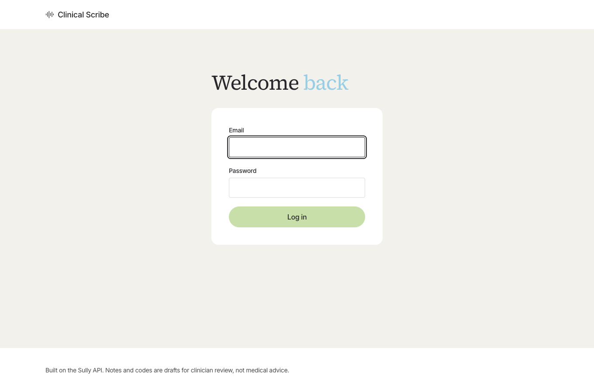
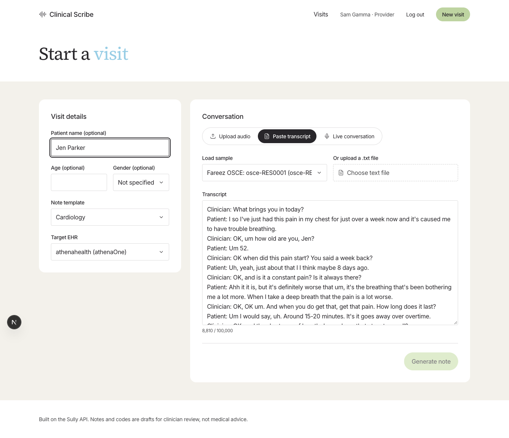
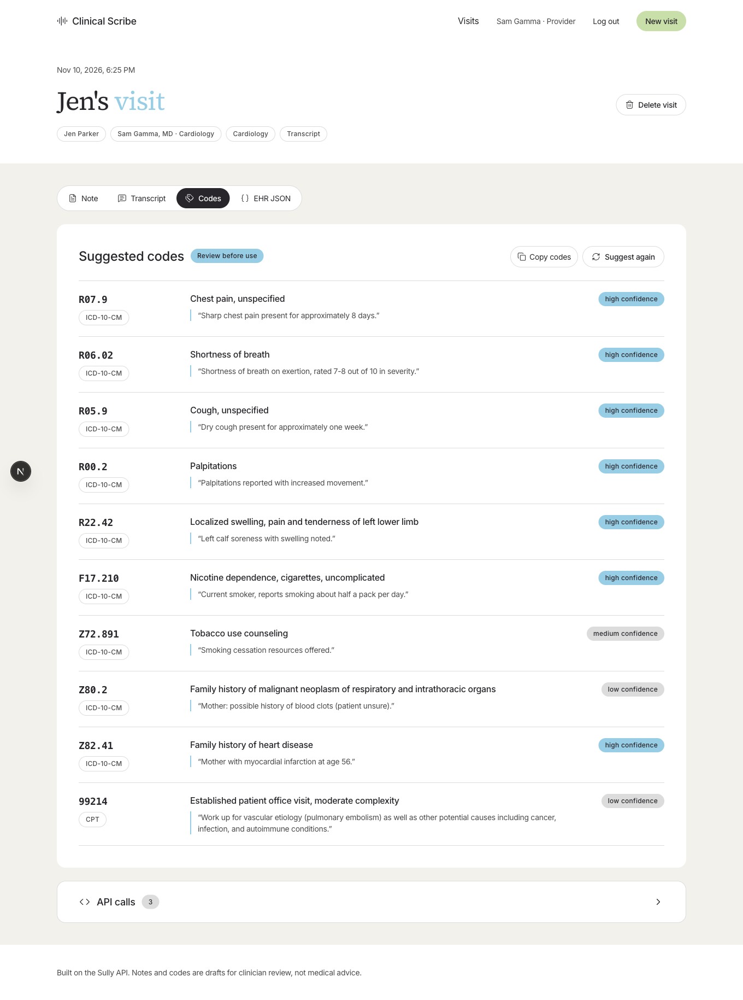

# Clinical Scribe

A working AI medical scribe built on the [Sully API](https://docs.sully.ai/). Capture a doctor-patient conversation, get a clinical note, suggested billing codes and EHR-ready JSON. Every Sully request is shown with a curl command you can run yourself.

It uses the rest of this repo directly: note templates from [`../templates`](../templates), EHR schemas from [`../ehr-schemas`](../ehr-schemas) and sample conversations from [`../dataset`](../dataset).





## What it does

1. **Log in** (`/login`): every page and API route needs a login. There are two roles, admin and provider.
2. **Provider accounts** (`/admin`, admin only): create, edit and delete provider accounts, and reset their passwords. Each provider has credentials, specialty, an optional NPI, a default note template, a default EHR, an email and a password. Deleting a provider removes their login; their visits are kept and marked "former provider".
3. **New visit** (`/visits/new`, providers only): the visit runs as the logged-in provider. Add optional patient details, keep or change the template (19 to choose from) and target EHR, then capture the conversation one of three ways:
   - **Upload audio**: a recording of your own, or a sample from the dataset.
   - **Paste transcript**: type, paste, upload a `.txt` file, or load a sample encounter.
   - **Live conversation**: record from the microphone and watch the transcript appear as people talk.
4. **Results** (`/visits/[id]`): note, transcript, suggested codes and EHR JSON, each with copy buttons.
5. **API calls panel**: every Sully request made for the visit, with redacted headers, the request body, status, latency, request ID and a ready-to-run curl.
6. **Visits list** (`/`): a provider sees only their own visits. The admin sees every visit, read only, with the provider for each.

## Roles

| | Admin | Provider |
|---|---|---|
| Manage provider accounts | Yes | No |
| Run visits | No | Yes, as themselves |
| See visits | All, read only | Only their own |

Another provider's visit returns "not found", both as a page and through the API.

## Setup

You need Node.js 20 or newer.

```bash
cd app
npm install
cp .env.example .env.local   # then add your Sully account ID and API key
npm run dev
```

Open http://localhost:3000.

`.env.local`:

```bash
SULLY_ACCOUNT_ID=your-account-id
SULLY_API_KEY=your-api-key
SULLY_API_BASE_URL=https://api.sully.ai

SESSION_SECRET=a-long-random-string     # openssl rand -hex 32
ADMIN_EMAIL=you@example.com
ADMIN_PASSWORD=a-strong-password
```

Get the Sully values from the Sully dashboard. Restart `npm run dev` after changing `.env.local`.

### Default logins

On first run the app creates two accounts in `data/accounts.json`:

| Role | Email | Password |
|---|---|---|
| Admin | `ADMIN_EMAIL`, or `admin@example.com` | `ADMIN_PASSWORD`, or `change-me` |
| Provider (demo) | `dr.chen@example.com` | `change-me` |

**Change these before anyone else can reach the app.** Set `ADMIN_EMAIL` and `ADMIN_PASSWORD` before the first run, then reset or delete the demo provider in `/admin`. The console warns when defaults are used. If `SESSION_SECRET` is empty, a random dev secret is saved in `data/session-secret`; set your own for anything shared.

Passwords are hashed with scrypt. The session is an httpOnly cookie signed with `SESSION_SECRET` (HMAC-SHA256), valid for 12 hours. Deleting `data/accounts.json` recreates the two default accounts.

## How each feature maps to the Sully API

| Feature | Sully endpoint | Code |
|---|---|---|
| Upload audio | `POST /v2/audio/transcriptions` (multipart, field `audio`), then poll `GET /v2/audio/transcriptions/{id}` until `completed` or `failed` | `app/api/transcriptions/`, `components/new-visit/AudioUpload.tsx` |
| Live conversation | `POST /v1/audio/transcriptions/stream/token` on the server, then the browser opens `wss://api.sully.ai/v1/audio/transcriptions/stream?account_id=...&api_token=...&sample_rate=16000&encoding=linear16` | `app/api/stream-token/`, `components/new-visit/LiveCapture.tsx`, `public/pcm-worklet.js` |
| Clinical note | `POST /v3/notes` with `transcript`, `template` (a file from `../templates`) and `clinicalContext.patient` | `lib/pipeline.ts` (`runNote`) |
| Suggested codes | `POST /openai/v1/chat/completions` with model `sully-m1` and `response_format: {type: "json_object"}` | `lib/coding.ts`, `lib/pipeline.ts` (`runCodes`) |
| EHR JSON | `POST /v1/utils/text-to-json` with the note as `text` and `../ehr-schemas/<ehr>/schema.json` as `schema` | `lib/pipeline.ts` (`runEhr`) |

All Sully requests go through one small typed client, [`lib/sully.ts`](lib/sully.ts), with one function per endpoint. It is a good place to start reading.

### How it is built

- Next.js (App Router, TypeScript), Tailwind CSS and lucide-react icons.
- Every Sully call happens in a server route. Your API key never reaches the browser. Live transcription uses a short-lived token, as the docs recommend.
- No automatic retries. Notes, transcriptions, Text to JSON and M1 requests are billable, and repeating a POST can create duplicate work. The app also refuses to start a second request for a step that is still running.
- Errors from Sully are turned into plain guidance in the UI: `400 invalid_request`, `401 unauthorized`, `402 insufficient_credits`, `404 endpoint_disabled` and `5xx` service errors each get their own message, with the request ID.
- Login is checked twice: `proxy.ts` turns away requests without a valid session cookie, and every page and route then loads the account and checks its role (`lib/auth.ts`).
- Data is saved as JSON files in `app/data/` (ignored by git): accounts, visits and API call logs. Delete the folder to start fresh.

```
app/
  app/                 pages and API routes
  components/          UI (new-visit/, visit/, admin/, ui/)
  lib/
    sully.ts           typed Sully client, one function per endpoint
    pipeline.ts        note -> codes + EHR JSON
    coding.ts          M1 prompt and code checks
    auth.ts            current user, role checks
    session.ts         signed session cookie
    password.ts        scrypt password hashing
    kit.ts             reads templates, EHR schemas and samples from the repo
    demo.ts            simulated responses for demo mode
    store.ts           JSON file store
  proxy.ts             login gate for every page and API route
  public/pcm-worklet.js  microphone audio to 16 kHz linear16 PCM
```

## Demo mode

Leave `SULLY_API_KEY` empty and the app still works end to end, so you can look around before you have keys. A badge on every screen reads "Demo mode: add your Sully keys in .env.local".

In demo mode no request is sent. Each request is still built exactly as it would be, so the API calls panel shows the real request body and curl, with a simulated response:

- **Transcription** returns the sample's human transcript. If you upload your own audio, you get a sample transcript instead.
- **Note** returns the encounter's clinician-written note from the dataset, or a clearly marked placeholder for encounters that do not have one.
- **Codes** come from a small keyword table, not M1.
- **EHR JSON** is filled in from simple text parsing, shaped to the chosen EHR's schema.
- **Live conversation** shows a message asking for keys.

## Limitations

- **Codes are suggestions.** Sully's dedicated Medical Coding API is coming soon. Until then the app asks Sully M1 to suggest ICD-10-CM and CPT codes from the note, quote its evidence and never invent codes. Suggestions whose quote cannot be found in the note are removed. A certified coder should review every code.
- **EHR JSON is not sent to the EHR.** Writing to an EHR needs your own app registration with that EHR, and each EHR accepts different data (see each folder in `../ehr-schemas`). `scripts/to_fhir.py` turns the JSON into a FHIR payload.
- **Notes need clinician review.** Generated notes are drafts.
- **Live transcription** needs a browser with microphone access and AudioWorklet support (current Chrome, Edge, Firefox and Safari). Speakers are not labeled in the live transcript.
- **Transcription language** is fixed to English (`language=en`). Change it in `lib/sully.ts` and `app/api/stream-token/route.ts`.
- **Local only.** Login is simple and local, meant for a demo or a small team on a trusted machine. Do not put real patient data in it.

The sample conversations are simulated and openly licensed. See [`../dataset/ATTRIBUTION.md`](../dataset/ATTRIBUTION.md).
